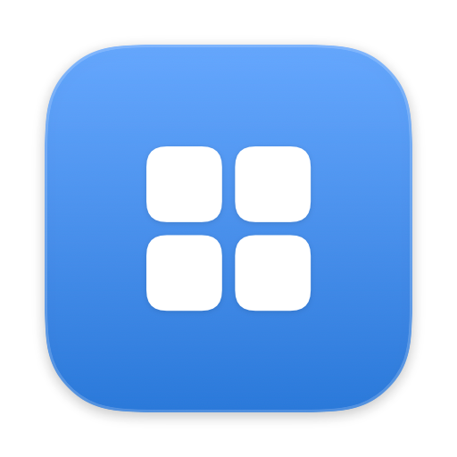
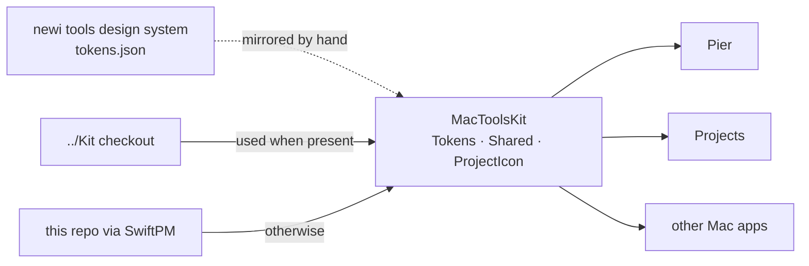
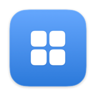
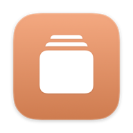
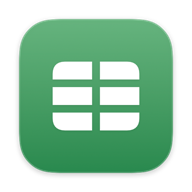
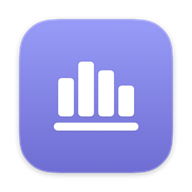
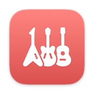

<div align="center">



# Kit (MacToolsKit)

**The shared Swift code behind the newi tools Mac apps.**

[](https://github.com/andrewneuwirth/mac-tools-kit/actions/workflows/ci.yml)
[](LICENSE)
[](Package.swift)
[](Package.swift)
[](Package.swift)

</div>

What's in it:

- the design-system tokens in Swift: colours, spacing, radii, motion, status, partner colours
- the usage reading Pier writes
- the project list Pier and Projects share
- the Open at Login toggle
- the icon plate generators (`tools/icon.swift`, `tools/icon-tile.swift`)

The tokens mirror the newi tools design system; change a value there and here together.



## Use it

The apps use a checkout next to them named `Kit` when there is one, otherwise SwiftPM fetches this repo. To work on
Kit and an app together, clone it next to the app:

```sh
git clone https://github.com/andrewneuwirth/mac-tools-kit.git Kit
```

`swift test` runs its checks.

## Tokens at a glance

Values from [`Sources/MacToolsKit/Tokens.swift`](Sources/MacToolsKit/Tokens.swift).

| Spacing (`MT.Space`) | Radius (`MT.Radius`) | Motion (`MT.Motion`) |
|---|---|---|
| 4 · 6 · 8 · 10 · 12 · 18 · 26 | control 8 · row 10 · card 14 · panel 18 · section 24 | quick 0.15 s ease · panel spring 0.3 s · value smooth 0.45 s (off under Reduce Motion) |

| Status | Light | Dark | | App accent | Colour |
|---|---|---|---|---|---|
| `mtGood` |  `#2f9e5b` |  `#66cc87` | | `mtJot` |  `#338cfa` |
| `mtWarn` |  `#b7791f` |  `#f2b545` | | `mtProjects` |  `#807ef2` |
| `mtBad` |  `#d64541` |  `#e85754` | | `mtHangar` |  `#ed8f5c` |
| | | | | `mtLinkChoice` |  `#fa5c5c` |
| **Partner** | | | | `mtCommandCenter` |  `#1fb6c9` |
| `mtClaude` |  `#d97757` | | | `mtVitals` |  `#8bc34a` |
| `mtChatGPT` |  `#10a37f` | | | `mtUsageRings` |  `#b98fdd` |

Usage status thresholds (`MTStatus.forUsage`): **50%** warns, **80%** is bad.

## Icon plates

`tools/icon-tile.swift` draws one colour and one SF Symbol on Apple's icon grid (an 824 tile inset 100 on the 1024
canvas, radius 185) and writes an `.icns` or `.png`. `tools/icon.swift` draws the family plate, with the accent
sunk into the dark ground.

```sh
swift tools/icon-tile.swift 338cfa square.grid.2x2.fill icon.png
swift tools/icon.swift <accent hex> <SF Symbol name | glyph.svg> <out.icns>
```

<p>
  
  
  
  
  
</p>

<sub>Output of `tools/icon-tile.swift` with five colours and symbols.</sub>

## BuildJanitor

[`tools/BuildJanitor`](tools/BuildJanitor/README.md) holds BuildJanitor, the Claude Code hook and nightly janitor that
keep agent Xcode builds and simulators from filling the disk (Python, see its README). Point its hooks at your
checkout's `tools/BuildJanitor` (or a symlink to it).

| 2,000+ | 67 GB | 3 |
|:---:|:---:|:---:|
| full clean builds in 30 days, none deleted, before BuildJanitor | of simulator copies piled up in CoreSimulator/Devices | shared, reused DerivedData slots per project after |

## License

[MIT](LICENSE). Contributing: [CONTRIBUTING.md](CONTRIBUTING.md). Security: [SECURITY.md](SECURITY.md).
